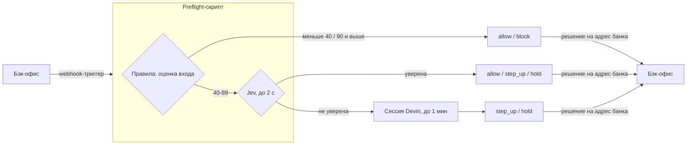

# Nightwatch

**Что.** Сервис на инфраструктуре Devin Cloud. Перед исходящей операцией бэк-офис банка присылает
один webhook со всеми данными и получает `allow`, `step_up`, `hold` или `block`. Своей базы нет:
всё, что нужно для решения, приходит в запросе. Как банк отправляет запрос и забирает ответ — за
рамками проекта.

**Принцип.** Решаем по поведению и контексту. Пройденные биометрия, KYC и вход — не повод доверять:
их обманывают дипфейк и украденные данные.

**Трек:** синий — человек и транзакция. Задание: [hackathon-brief.md](hackathon-brief.md).

## Как принимается решение



1. **Webhook-триггер** автоматизации принимает запрос. Одна автоматизация на банк, свой адрес и секрет.
2. **Preflight-скрипт** (отдельная короткая машина, до сессии Devin) считает правила и спрашивает Jev.
   Ясный случай — сам отправляет решение и пишет `{"run": false}`: сессия Devin не стартует.
3. **Спорный случай** — скрипт пишет `{"items": [...]}`, и стартует сессия Devin. Она получает
   **исходный запрос целиком, без изменений**, а рядом, отдельным блоком, — оценку правил и ответ Jev
   (item скрипта). Решает и отправляет решение.
4. **Решение** уходит на адрес банка (`reply.url` в конфигурации). Как банк его принимает — за рамками
   проекта.

Время (замер): Jev 0,27–0,40 с; сессия Devin — около 10 с. Запуск preflight-машины ещё не замерен.

## Вход: один webhook

| Блок | Поля | Предел |
|---|---|---|
| `transaction` | `transaction_id`, `requested_at`, `amount`, `channel` | — |
| `customer` | `customer_id` (псевдоним), `timezone` | — |
| `session` | `authenticated_at`, `auth_factors`, `device_id`, `device_first_seen_at`, `last_password_reset_at`, `last_mfa_change_at`, `network {ip_ref, ip_country, anonymizer}` | — |
| `history.recent_login_attempts` | `occurred_at`, `outcome`, `device_id`, `network` | последние 50 за 30 дней, новые первыми |
| `history.baseline` (необязательно) | `typical_active_local_hours`, `login_countries`, `lookback_days` | стран до 10, окно до 90 дней |

- **Тело до 32 КБ**, обычно около 8 КБ (50 входов по ~150 Б). Почему: webhook Devin режет тело на
  200 КБ, Jev принимает до ~32 000 токенов на вопрос, маленький промпт быстрее.
- **Сверх предела** (больше 50 входов, старше 30 дней) — правила и Jev берут самые новые. Devin в
  спорном случае видит запрос как есть.
- **Меньше 5 успешных входов** и нет `baseline` — «необычную страну» и «необычный час» не считаем;
  Jev и Devin видят флаг `thin_history`.
- **Без персональных данных:** IP — только `ip_ref` (хэш) и страна; имя, телефон, номера счетов не
  нужны.
- **Не нужно в фазе 1:** `policy.fast_path_budget`, `recent_outgoing_requests`, `windows`, получатель,
  баланс.

## Фаза 1: аномалии входа

| Сигнал, код причины | Условие | Откуда | Вес |
|---|---|---|---|
| Новое устройство `new_device` | впервые меньше 24 ч назад | `session.device_first_seen_at` | 30 |
| Сброс доступа `recent_password_reset`, `recent_mfa_change` | пароль или MFA сменены меньше 24 ч назад | `session.last_*_at` | 25 |
| Анонимайзер `anonymizer_network` | VPN, Tor, прокси | `session.network.anonymizer` | 20 |
| Необычная страна `ip_country_unusual` | страны нет среди успешных входов | `baseline.login_countries` или история | 20 |
| Неудачные входы `failed_login_attempts` | 3+ неудачные попытки за 1 ч до входа | история | 15 |
| Необычный час `off_hours` | вход вне обычных часов клиента | `baseline.typical_active_local_hours` или история | 10 |
| Быстро к операции `login_to_transfer_fast` | от входа до операции меньше 60 с | `authenticated_at`, `requested_at` | 10 |

Пример: злоумышленник с нового устройства через VPN ночью сразу идёт к переводу → 30 + 20 + 10 + 10 =
70. Плюс чужая страна → 90 → `block`. Alice со своего телефона днём → 0 → `allow`.

## Решение

| Оценка правил | Что дальше |
|---|---|
| меньше 40 | `allow`, правила |
| 40–89 | Jev |
| 90 и выше | `block`, правила |

| Вероятность захвата от Jev | Решение |
|---|---|
| меньше 0,2 | `allow`; при оценке 60–89 — `step_up` |
| 0,2–0,4 | `step_up` |
| 0,4–0,6 или уверенность метки меньше 0,5 | Jev не уверена → Devin: `step_up` или `hold` |
| 0,6 и выше | `hold` |

- **Jev не ответила за 2 с** → по оценке: 40–59 `step_up`, 60–89 `hold`. **Devin не ответил за
  1 мин** → `hold`.
- **Модели не выходят за правила:** Jev и Devin не дают `block` и не отпускают оценку 60–89 без
  проверки. `block` — правила или владелец.
- **`step_up`** — ещё одно подтверждение в текущей сессии банка (экран с предупреждением, биометрия,
  PIN, код).
- **`hold`** — перевод остановлен, владельца спрашиваем вне сессии банка: звонок, пуш на старое
  устройство. Срок 15 мин, по таймауту `block`. Пока ждём — `final: false`.

## Jev и Devin

| | Jev (TypeSafe) | Devin |
|---|---|---|
| Роль | быстрый классификатор | агент: думает, объясняет, ищет схемы |
| Где | preflight-скрипт автоматизации | сессия, которую запускает автоматизация |
| Когда | каждая операция с оценкой 40–89 | после Jev: неуверенные случаи; разбор `hold` и `block`; раз в час — поиск схем |
| Вход | запрос + сработавшие сигналы и оценка | то же + ответ Jev |
| Выход | вероятность захвата (да/нет) и метка (выбор), без текста | решение в неуверенной зоне, объяснение для клиента и аналитика, разбор дела, PR в конфигурацию |
| Время (замер) | 0,27–0,40 с, срок 2 с | сессия создаётся за 1,4 с, ответ около 10 с, срок 1 мин |
| Цена | ~730 входных токенов на вызов по $0,042 за 1 млн — практически ноль | сессия Devin |

Jev вызывает preflight-скрипт (`POST https://api.typesafe.ai/v1/systemone`, ключ в секретах
организации). В ясных случаях объяснение собирается из сработавших сигналов: Jev текста не даёт.
Подробные объяснения и разбор пишет Devin.

## Фаза 2 (после хакатона)

- **Бюджет без проверки:** окно 6 ч, до 5 операций и AED 2 000 (каждая до AED 1 000), в рискованном
  контексте ×0,1.
- **Сигналы операции:** сумма от 3× обычной, новый получатель за границей, всплеск, доля баланса,
  дробление, веер, дневной объём, мул.
- **Поиск схем по потоку** (Devin) с предложениями в конфигурацию.

## Что выбрать в Devin

Automations → Create automation:

| Часть | Выбор | Зачем |
|---|---|---|
| Trigger | **Webhook** (`webhook:incoming`) | приём запроса; одна автоматизация на банк |
| Conditions | не нужны | простые фильтры по телу, порогов там нет |
| Preflight check | **Run a script**, Node; секрет `TYPESAFE_API_KEY`; срок 10 с | правила + Jev; ясный случай решает сам |
| ↳ LLM filter | не брать | медленнее Jev и делает то же хуже |
| Action | **Start session**, промпт с `@skills:nightwatch-decision` | Devin для спорных случаев |
| Limits | ACU на сессию 1–2; запусков в окне; очередь | верхний предел по деньгам и нагрузке |
| Вторая автоматизация | **Schedule**, раз в час | поиск схем → PR в конфигурацию с цифрами: сколько поймали бы, сколько честных задели бы |

- **Preflight-скрипт:** Python, Node или Bash, до 256 КБ, срок 1–300 с. Читает событие из
  `$EVENT_FILE`, решение пишет в `$OUTPUT_FILE`. Не уложился в срок — ни решения, ни сессии,
  поэтому свои сроки (Jev 2 с) короче.
- **Сессия от автоматизации** получает исходное событие целиком, без изменений (Devin так делает сам),
  плюс item скрипта отдельным блоком. Тело больше 200 КБ Devin обрежет — поэтому предел 32 КБ. Схему
  ответа сессии задать нельзя: формат — текстом в скилле.
- **Скилл** `.agents/skills/nightwatch-decision/SKILL.md` в репозитории; **знания** (knowledge notes) —
  признаки захвата для Devin; **Devin App** — консоль (приватная, вход через Devin).

## Конфигурация (на банк, `config/<bank>.yaml`)

```yaml
input: { maxLoginAttempts: 50, loginLookbackDays: 30, maxBodyKb: 32, minSuccessfulLogins: 5 }
loginSignals: { newDevice: 30, accessReset: 25, anonymizer: 20, unusualCountry: 20, failedLogins: 15, unusualHour: 10, fastToTransaction: 10 }
loginWindows: { newDeviceHours: 24, accessResetHours: 24, failedLoginsHour: 3, fastToTransactionSeconds: 60 }
decisions: { jev: 40, block: 90 }
jev: { model: jev-latest, timeoutMs: 2000, thresholds: { stepUp: 0.2, devin: 0.4, hold: 0.6, minLabelConfidence: 0.5 } }
devin: { timeoutMs: 60000, skill: nightwatch-decision, patternScan: hourly }   # срок Devin, по умолчанию 1 мин
preflight: { timeoutSeconds: 10 }
reply: { url: "https://bank.example/nightwatch/decisions" }   # куда отправлять решение
confirmation: { timeoutMinutes: 15, onTimeout: block }
```

Ключи — в секретах Devin, не в файле. Скрипт настройки собирает preflight из кода и этого файла.

## Демо (5 мин)

1. Alice входит со своего телефона днём и платит → `allow` по правилам.
2. 02:00: злоумышленник прошёл FaceID и KYC от имени Alice — новое устройство, VPN, сразу к переводу.
3. Перевод AED 450 000 → preflight: оценка 70, Jev — захват 0,80 → `hold` за секунду, без сессии Devin.
4. «Телефон Alice»: «Это вы?» → «Нет» → `block`, деньги на месте.
5. Спорный вход (новая страна, Jev не уверена) → сессия Devin разбирает и объясняет → `hold` или `step_up`.
6. Консоль (Devin App): сигналы, ответ Jev, разбор Devin. Поиск схем: PR с правкой порогов.

## Состав

- **Репозиторий:** правила и вызов Jev (TypeScript, собирается в preflight-скрипт), схемы,
  `config/`, скилл в `.agents/skills/`, знания в `devin/knowledge/`, скрипт настройки: секреты,
  автоматизации и знания через API v3.
- **Демо-банк:** страница — шлёт webhook и показывает пришедшие решения. Только для показа.
- **Консоль:** Devin App.

## Проверено на аккаунте (21.11)

Организация Devin Андрея, API v3; Jev — ключ команды.
- **Jev:** атака → захват 0,80, метка «захват» 0,86; обычный вход → 0,04; спорный вход → 0,65, но
  уверенность метки 0,22 — поэтому «не уверена» считаем и по уверенности метки.
- **Devin:** сессия через API со схемой ответа — создана за 1,4 с, работает с 2,3 с, structured output
  через ~10 с (режим `fast`), 0 ACU на счётчике. Ответ осмысленный: `hold` с объяснением для аналитика.
- **В организации:** плейбуки выключены («Skills only»), знания, секреты и автоматизации доступны через
  API (пока пусты), репозиторий `nightwatch` подключён и проиндексирован.
- **Не проверено:** включены ли preflight-скрипты (Devin их ещё раскатывает), сколько стартует
  preflight-машина, отдаёт ли сессия от webhook ответ по тексту скилла.

## Сроки

Заморозка кода 15:30 · сдача 16:00 (GitHub + видео в Cap) · демо 16:30.

## Открыто

- Настроить в организации Андрея (секрет Jev, две автоматизации) и замерить — ждёт «да».
- Если preflight-скрипты не включены — правила и Jev переезжают в сессию, каждое решение около 10 с.
- Схема запроса под фазу 1: всё лишнее необязательно, у `recent_login_attempts` предел 50, в
  `baseline` поле `login_countries`. Согласовать с Андреем.
- Схема `step_up`: каналы только в сессии банка; в запросе поле `step_up_result`. Согласовать с
  Андреем.
- Название — Nightwatch?
