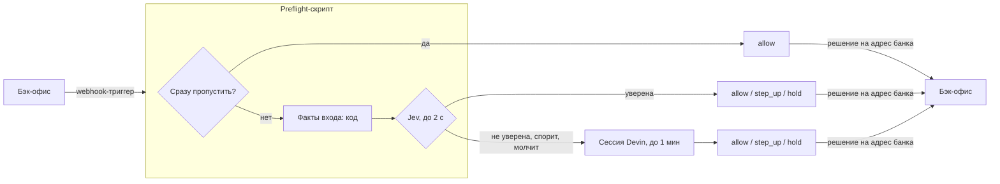

# Nightwatch

**Что.** Сервис на инфраструктуре Devin Cloud. Перед исходящей операцией бэк-офис банка присылает
один webhook со всеми данными и получает `allow`, `step_up`, `hold` или `block`. Своей базы нет:
всё, что нужно для решения, приходит в запросе. Как банк отправляет запрос и забирает ответ — за
рамками проекта.

**Принцип.** Решаем по поведению и контексту. Пройденные биометрия, KYC и вход — не повод доверять:
их обманывают дипфейк и украденные данные.

**Трек:** синий — человек и транзакция. Задание: [hackathon-brief.md](hackathon-brief.md).

## Как принимается решение



1. **Webhook-триггер** автоматизации принимает запрос. Одна автоматизация на банк, свой адрес и секрет.
2. **Preflight-скрипт** (отдельная короткая машина, до сессии Devin) сначала проверяет, можно ли
   сразу пропустить, затем считает факты входа и спрашивает Jev. Весов нет: решает Jev.
   Ясный случай — сам отправляет решение и пишет `{"run": false}`: сессия Devin не стартует.
3. **Спорный случай** — скрипт пишет `{"items": [...]}`, и стартует сессия Devin. Она получает
   **исходный запрос целиком, без изменений**, а рядом, отдельным блоком, — факты и ответ Jev
   (item скрипта). Решает и отправляет решение.
4. **Решение** уходит на адрес банка (`reply.url` в конфигурации). Как банк его принимает — за рамками
   проекта.

Время (замер): от webhook до итога preflight — 12–28 с, почти всё — запуск preflight-машины; Jev внутри —
0,30–0,61 с; сессия Devin — ещё около 10 с.

## Вход: один webhook

| Блок | Поля | Предел |
|---|---|---|
| `transaction` | `transaction_id`, `requested_at`, `amount`, `amount_policy_minor` (в валюте `policy.currency`, AED), `channel` | — |
| `customer` | `customer_id` (псевдоним), `timezone` | — |
| `session` | `authenticated_at`, `auth_factors`, `device_id`, `device_first_seen_at`, `last_password_reset_at`, `last_mfa_change_at`, `network {ip_ref, ip_country, anonymizer}` | — |
| `history.recent_login_attempts` | `occurred_at`, `outcome`, `device_id`, `network` | последние 50 за 30 дней, новые первыми |
| `history.windows.24h` | `attempted_count`, `attempted_amount_policy_minor` | два числа |

- **Тело до 32 КБ**, обычно около 8 КБ (50 входов по ~150 Б). Почему: webhook Devin режет тело на
  200 КБ, Jev принимает до ~32 000 токенов на вопрос, маленький промпт быстрее.
- **Сверх предела** (больше 50 входов, старше 30 дней) — факты считаем по самым новым. Devin в
  спорном случае видит запрос как есть.
- **Меньше 5 успешных входов** в истории — «необычную страну» и «необычный час» не считаем;
  Jev и Devin видят флаг `thin_history`.
- **Без персональных данных:** IP — только `ip_ref` (хэш) и страна; имя, телефон, номера счетов не
  нужны.
- **Не используем:** `policy.fast_path_budget`, `recent_outgoing_requests`, окна кроме `24h`,
  страна получателя, баланс.

## Сразу пропускаем

До Jev, без моделей, только по полям текущей [схемы запроса](nightwatch-risk-request.schema.json).
Сработало → `allow` (`decided_by: fast_path`, код `small_amount`) за миллисекунды, без Jev и Devin.

| Правило | Условие | Поля |
|---|---|---|
| Мелкая сумма | меньше AED 10 000, и за 24 ч вместе с этой операцией не больше AED 20 000 и 5 операций | `transaction.amount_policy_minor`, `history.windows.24h` |

**Но не пропускаем, если есть хоть один сильный признак захвата** — тогда сразу к Jev:
- новое устройство (впервые меньше 24 ч назад);
- пароль или MFA сменены меньше 24 ч назад;
- Tor;
- 3+ неудачные попытки входа за 1 ч до входа.

Худший случай — захватчик без этих признаков (например, со взломанного телефона владельца): за сутки
уйдёт не больше AED 20 000 мелкими переводами. Дальше дневной предел отправит операции к Jev.

## Факты для Jev

Весов и суммы баллов нет. Код только считает факты из запроса — разницу во времени и сравнение с
историей модель считает хуже кода. Решает Jev.

| Факт, код причины | Что считаем | Откуда |
|---|---|---|
| Возраст устройства `new_device` | минут с первого появления устройства | `session.device_first_seen_at` |
| Сброс доступа `recent_password_reset`, `recent_mfa_change` | часов со смены пароля и MFA | `session.last_*_at` |
| Анонимайзер `anonymizer_network` | VPN, Tor, прокси или нет | `session.network.anonymizer` |
| Страна `ip_country_unusual` | была ли среди успешных входов | история входов |
| Неудачные входы `failed_login_attempts` | сколько за 1 ч до входа | история входов |
| Час входа `off_hours` | был ли этот час (по `customer.timezone`) среди успешных входов | история входов |
| От входа до операции `login_to_transfer_fast` | секунд | `authenticated_at`, `requested_at` |
| Короткая история `thin_history` | успешных входов меньше 5 | история входов |

### Как Jev получает запрос

Один вызов `POST https://api.typesafe.ai/v1/systemone`. В `state` — **исходный webhook без изменений** и
рядом факты; вопросы ссылаются на поля путями в обратных кавычках. Примеры целиком:
[атака](examples/jev-attack.json), [обычный вход](examples/jev-normal.json).

```json
{
  "model": "jev-latest",
  "state": {
    "request": { "…": "исходный webhook как есть" },
    "facts": { "device_age_minutes": 2, "hours_since_password_reset": null, "anonymizer": "vpn",
               "country_seen_in_successful_logins": true, "failed_logins_1h_before": 0,
               "login_hour_local": 2, "hour_seen_in_successful_logins": false,
               "seconds_login_to_transfer": 20, "successful_logins_in_history": 49, "thin_history": false }
  },
  "questions": {
    "takeover": { "type": "noul", "instructions": "Is this session operated by someone other than the owner? Judge `request.session` against `request.history.recent_login_attempts`, using `facts`." },
    "pattern": { "type": "choice", "instructions": "Which reading of this login fits best?",
                 "criteria": { "legitimate": "…", "account_takeover": "…", "uncertain": "…" } }
  }
}
```

Ответ: `takeover` — вероятность захвата 0–1, `pattern` — метка и уверенность в ней.

**Почему запрос целиком** (замер, атака / обычный вход, вероятность захвата):

| Что в `state` | Атака | Обычный | Токенов | Время |
|---|---|---|---|---|
| исходный запрос + факты | 0,62–0,67 | 0,05 | ~5 900 | 0,30–0,61 с |
| запрос без истории входов + факты | 0,49 | 0,05 | ~1 000 | 0,30–0,54 с |
| только факты | 0,51 | 0,28 | ~550 | 0,43–0,61 с |

История входов в исходном виде даёт Jev больше всего: без неё атака и обычный вход сближаются.

## Решение

| Вероятность захвата от Jev | Решение |
|---|---|
| меньше 0,2 | `allow` |
| 0,2–0,6 | `step_up` |
| 0,6 и выше | `hold` |

**Эскалация в Devin** — в любом из случаев:
- Jev не уверена: уверенность метки меньше 0,5;
- Jev спорит сама с собой: захват 0,6+ при метке «законный» или меньше 0,2 при метке «захват»;
- Jev не ответила за 2 с или ошиблась.

Devin отвечает `allow`, `step_up` или `hold`; не ответил за 1 мин → `hold`.

Замер на полном запросе: атака — захват 0,62–0,67, метка «захват» 0,56–0,66 → `hold`. Обычный вход —
0,05, «законный» 0,91 → `allow`. Атака близко к порогу 0,6 — пороги и формулировку вопроса подбираем
на ~20 размеченных случаях.

- **`block` ставит только владелец:** ответ «нет» на `hold` или таймаут 15 мин. Модели не блокируют —
  при `hold` деньги и так стоят.
- **`step_up`** — ещё одно подтверждение в текущей сессии банка (экран с предупреждением, биометрия,
  PIN, код).
- **`hold`** — перевод остановлен, владельца спрашиваем вне сессии банка: звонок, пуш на старое
  устройство. Срок 15 мин, по таймауту `block`. Пока ждём — `final: false`.

## Jev и Devin

| | Jev (TypeSafe) | Devin |
|---|---|---|
| Роль | быстрый классификатор | агент: думает, объясняет, ищет схемы |
| Где | preflight-скрипт автоматизации | сессия, которую запускает автоматизация |
| Когда | каждая операция, которую не пропустили сразу | после Jev: не уверена, спорит сама с собой, не ответила; разбор `hold`; раз в час — поиск схем |
| Вход | исходный запрос + факты | исходный запрос + факты + ответ Jev |
| Выход | вероятность захвата (да/нет) и метка (выбор), без текста | решение в неуверенной зоне, объяснение для клиента и аналитика, разбор дела, PR в конфигурацию |
| Время (замер) | 0,30–0,61 с на полном запросе, срок 2 с | сессия создаётся за 1,4 с, ответ около 10 с, срок 1 мин |
| Цена | ~5 900 входных токенов на вызов по $0,042 за 1 млн — $0,00025 | сессия Devin |

**Откуда у Jev вероятность.** Jev — обученная модель-классификатор, не чат. Она читает наш JSON и текст
вопроса и выдаёт распределение по ответам, без генерации текста. Вероятность — её оценка по смыслу
вопроса и данным, а не статистика мошенничества банка: на наших данных Jev не учится. Поэтому управляем
формулировкой вопроса и описаниями вариантов, а пороги подбираем на наборе из ~20 размеченных случаев.

Jev вызывает preflight-скрипт (`POST https://api.typesafe.ai/v1/systemone`, ключ в секретах
организации). В ясных случаях объяснение собирается из фактов: Jev текста не даёт. Подробные объяснения
и разбор пишет Devin.

## Что выбрать в Devin

Automations → Create automation:

| Часть | Выбор | Зачем |
|---|---|---|
| Trigger | **Webhook** (`webhook:incoming`) | приём запроса; одна автоматизация на банк |
| Conditions | не нужны | простые фильтры по телу, порогов там нет |
| Preflight check | **Run a script**; секрет `TYPESAFE_API_KEY`; срок 10 с | быстрый пропуск, факты, Jev; ясный случай решает сам |
| ↳ LLM filter | не брать | медленнее Jev и делает то же хуже |
| Action | **Start session**, промпт с `@skills:nightwatch-decision` | Devin для спорных случаев |
| Limits | ACU на сессию 1–2; запусков в окне; очередь | верхний предел по деньгам и нагрузке |
| Вторая автоматизация | **Schedule**, раз в час | поиск схем → PR в конфигурацию с цифрами: сколько поймали бы, сколько честных задели бы |

- **Preflight-скрипт — Python** (`preflight/`): Node на этой машине нет (проверено), другое окружение через
  API не выбрать. Решение целиком внутри Devin: preflight на Python, спорное — сессия Devin.
  Nest-приложение — демо-банк для теста (принимает решения, шлёт сценарии). До 256 КБ, срок 1–300 с. Читает событие из
  `$EVENT_FILE`, решение пишет в `$OUTPUT_FILE`. Не уложился в срок — ни решения, ни сессии,
  поэтому свои сроки (Jev 2 с) короче.
- **Сессия от автоматизации** получает исходное событие целиком, без изменений (Devin так делает сам),
  плюс item скрипта отдельным блоком. Тело больше 200 КБ Devin обрежет — поэтому предел 32 КБ. Схему
  ответа сессии задать нельзя: формат — текстом в скилле.
- **Скилл** `.agents/skills/nightwatch-decision/SKILL.md` в репозитории; **знания** (knowledge notes) —
  признаки захвата для Devin; **Devin App** — консоль (приватная, вход через Devin).

## Конфигурация (на банк, `config/<bank>.yaml`)

```yaml
input: { maxLoginAttempts: 50, loginLookbackDays: 30, maxBodyKb: 32, minSuccessfulLogins: 5 }
fastAllow: { maxAmount: 10000, daily: { maxTotal: 20000, maxCount: 5 } }   # AED, в запросе — в филсах (×100)
fastAllowStoppers: { newDeviceHours: 24, accessResetHours: 24, tor: true, failedLoginsHour: 3 }
facts: { failedLoginsWindowMinutes: 60 }
jev: { model: jev-latest, timeoutMs: 2000, thresholds: { stepUp: 0.2, hold: 0.6 } }
escalate: { minLabelConfidence: 0.5, onConflict: true, onJevFailure: true }
devin: { timeoutMs: 60000, skill: nightwatch-decision, patternScan: hourly }   # срок Devin, по умолчанию 1 мин
preflight: { timeoutSeconds: 10 }
reply: { url: "https://bank.example/nightwatch/decisions" }   # куда отправлять решение
confirmation: { timeoutMinutes: 15, onTimeout: block }
```

Ключи — в секретах Devin, не в файле. Скрипт настройки собирает preflight из кода и этого файла.

## Демо (5 мин)

1. Alice платит AED 85 за ужин → `allow` сразу, мелкая сумма. Потом AED 15 000 арендодателю со своего
   телефона → Jev: захват 0,04 → `allow` за 0,3 с.
2. 02:00: злоумышленник прошёл FaceID и KYC от имени Alice — новое устройство, VPN, сразу к переводу.
3. Перевод AED 450 000 → preflight: Jev — захват 0,65, метка «захват» 0,6 → `hold` за секунду, без
   сессии Devin.
4. «Телефон Alice»: «Это вы?» → «Нет» → `block`, деньги на месте.
5. Спорный вход (новая страна, Jev не уверена) → сессия Devin разбирает и объясняет → `hold` или `step_up`.
6. Консоль (Devin App): факты, ответ Jev, разбор Devin. Поиск схем: PR с правкой порогов.

## Состав

- **Репозиторий:** быстрый пропуск, факты и вызов Jev (TypeScript, собирается в preflight-скрипт), схемы,
  `config/`, скилл в `.agents/skills/`, знания в `devin/knowledge/`, скрипт настройки: секреты,
  автоматизации и знания через API v3.
- **Демо-банк:** страница — шлёт webhook и показывает пришедшие решения. Только для показа.
- **Консоль:** Devin App.

## Проверено на аккаунте (21.11)

Организация Devin Андрея, API v3; Jev — ключ команды.
- **Jev:** на полном запросе атака → 0,62–0,67, обычный вход → 0,05 (таблица выше). Раньше было 0,80
  на сжатом описании со старой суммой весов — она подсказывала ответ. Спорный вход на сжатом описании:
  0,65 при уверенности метки 0,22 — поэтому «не уверена» считаем и по уверенности метки.
- **Devin:** сессия через API со схемой ответа — создана за 1,4 с, работает с 2,3 с, structured output
  через ~10 с (режим `fast`), 0 ACU на счётчике. Ответ осмысленный: `hold` с объяснением для аналитика.
- **В организации:** плейбуки выключены («Skills only»), знания, секреты и автоматизации доступны через
  API (пока пусты), репозиторий `nightwatch` подключён и проиндексирован.
- **Автоматизация создана** (`nightwatch-decide-demo-bank`): webhook с секретом, секрет организации
  `TYPESAFE_API_KEY`, лимит 2 ACU на сессию, до 5 сессий одновременно. Preflight-скрипты в организации
  включены; скрипт видит секрет и ходит в Jev; runtime `node` падает даже на пустом скрипте.
- **Сквозной прогон через Devin (21.11, 13:41):** webhook → preflight на Python → решение на адрес банка.
  Ужин AED 85 → `allow`, быстрый пропуск; аренда AED 15 000 с телефона Alice → Jev 0,07 → `allow`;
  атака → Jev 0,82, «захват» 0,88 → `hold`. Jev внутри — 82–90 мс; первое решение у банка через ~20 с
  после webhook, три подряд — за 32 с.
- **API не показывает журнал запусков:** только итог последнего (`succeeded`, `failed`, `skipped`).
  Решения видим там, куда их отправляет скрипт, — на странице демо-банка.

## Сроки

Заморозка кода 15:30 · сдача 16:00 (GitHub + видео в Cap) · демо 16:30.

## Открыто

- Подключить скилл к автоматизации, когда он будет в репозитории; адрес демо-банка — туннель с Мака.
- Схема запроса: всё лишнее необязательно, у `recent_login_attempts` предел 50,
  `history.baseline` убрать. Согласовать с Андреем.
- Схема `step_up`: каналы только в сессии банка; в запросе поле `step_up_result`. Согласовать с
  Андреем.
- Название — Nightwatch?
