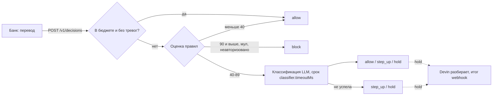

# Nightwatch

**Что.** SaaS перед бэк-офисом банка. Перед каждой исходящей операцией банк синхронно спрашивает
Nightwatch и получает `allow`, `step_up`, `hold` или `block`.

**Принцип.** Решаем по поведению и контексту. Пройденные биометрия, KYC и вход — не повод доверять:
их обманывают дипфейк и украденные данные.

**Трек:** синий — человек и транзакция. Задание: [hackathon-brief.md](hackathon-brief.md).

## Как принимается решение



## Пороги

| | Значение |
|---|---|
| Бюджет без проверки | окно 6 ч: до 5 операций, до AED 2 000 в сумме, каждая до AED 1 000 |
| Рискованный контекст | ночь 00–05, устройство моложе 24 ч, сессия моложе 10 мин, сброс пароля или биометрии |
| Бюджет в рискованном контексте | ×0,1 → 1 операция, AED 200 |
| Всегда проверка | больше AED 1 000, новый получатель за границей, больше 20% баланса |

## Сигналы

| Сигнал | Условие | Вес |
|---|---|---|
| Новое устройство | впервые меньше 24 ч назад | 25 |
| Сеть | VPN, Tor, прокси, необычная страна IP | 15 |
| Быстро к переводу | от входа меньше 60 с | 15 |
| Сумма | от 3× обычной | 20 |
| Новый получатель за границей | | 15 |
| Всплеск | 3+ перевода новым получателям за 10 мин | 25 |
| Доля баланса | больше 30% за 1 ч | 30 |
| Дробление | 3+ суммы у порога (80–100%) за 1 ч | 30 |
| Веер | 3+ новых получателя за 1 ч | 15 |
| Дневной объём | больше 2× дневного максимума за 30 дней | 15 |
| Мул | на этот IBAN шли деньги других жертв | 40 |

## Оценка → решение

| Оценка | Решение | Кто решает |
|---|---|---|
| меньше 40 | `allow` | правила |
| 40–59 | `step_up` | LLM в границах правил |
| 60–89 | `hold` | LLM в границах правил (не ниже `step_up`) |
| 90 и выше | `block` | правила |

- **LLM не успела за `classifier.timeoutMs`** (по умолчанию 60 000 мс = 1 мин) → запасное правило из
  `classifier.fallback`: 40–59 → `step_up`, 60–89 → `hold`. Банк держит запрос до этого срока: его
  таймаут на вызов должен быть больше.
- **Ответ LLM проверяется:** значения только из списков, коды причин только из сигналов.
- **`step_up`** — ещё одно подтверждение в текущей сессии (экран с предупреждением, биометрия, PIN,
  код). Для среднего риска.
- **`hold`** — перевод остановлен, владельца спрашиваем вне сессии: звонок, пуш на старое
  устройство. Срок 15 мин, по таймауту `block`. Решение не окончательное (`final: false`), итог —
  webhook и `GET /v1/decisions/{id}`.

## API

| Метод | Зачем |
|---|---|
| `POST /v1/decisions` | решение до исполнения: [запрос](nightwatch-risk-request.schema.json), [ответ](nightwatch-risk-response.schema.json) |
| `POST /v1/events` | входы, новые устройства, сбросы пароля |
| `GET /v1/decisions/{id}` | окончательное решение по `hold` |
| webhook → банк | решение изменилось, заведено дело |

У каждого банка свои ключ, конфигурация и данные. Работает у нас (SaaS) или контейнером в контуре банка.

## Анализ (Devin)

| Что | Когда | Результат |
|---|---|---|
| Разбор дела | пока операция в `hold` | вердикт, уверенность, объяснение для аналитика и клиента |
| Поиск схем | раз в час и по кнопке | предложения в конфигурацию с цифрами: сколько поймали бы и сколько честных задели бы; для новой логики — PR с правилом и тестом |

Классификация в серой зоне тоже на Devin: вызов через Devin CLI — около 6–8 с, в минуту по умолчанию укладывается.

## Конфигурация (на банк)

```yaml
budget: { windowHours: 6, maxCount: 5, maxTotal: 2000, maxPerTransaction: 1000 }
riskyContext: { nightHours: "00:00-05:00", newDeviceHours: 24, freshSessionMinutes: 10, budgetFactor: 0.1 }
decisions: { stepUp: 40, hold: 60, block: 90 }
classifier: { timeoutMs: 60000, fallback: { stepUp: step_up, hold: hold } }   # срок LLM, по умолчанию 1 мин
highRiskCountries: [MU, KY, VG, SC, PA]
confirmation: { channel: push, timeoutMinutes: 15, onTimeout: block }
analyst: { provider: devin, apiKey: "apk_...", baseUrl: https://api.devin.ai, patternScan: hourly }
```

## Демо (5 мин)

1. Честные операции: кофе AED 35 и обычный платёж Alice проходят мгновенно.
2. 02:00: злоумышленник прошёл FaceID и KYC от имени Alice, новое устройство, VPN.
3. Перевод AED 450 000 на новый счёт на Маврикии → оценка 92, `hold`.
4. Попытка частями → бюджет кончился, всплеск и дробление → `hold`.
5. «Телефон Alice»: «Это вы?» → «Нет» → `block`, сессия оборвана, деньги на месте.
6. Дело в консоли: разбор Devin.
7. Devin нашёл мула → правка конфигурации одной кнопкой → повтор ловится раньше.

## Состав

- **API Nightwatch** (NestJS): решения, события, webhook, конфигурация, дела.
- **Демо-банк:** счета, переводы, вызывает `POST /v1/decisions`; сценарий атаки; экран «телефон Alice».
- **Консоль:** живые решения, дела, аналитика, конфигурация.
- **Postgres:** банки, конфигурации, решения, дела.

## Сроки

Заморозка кода 15:30 · сдача 16:00 (GitHub + видео в Cap) · демо 16:30.

## Открыто

- Название — Nightwatch?
- Предложения Devin в демо: правка конфигурации или PR?
- Схема `step_up`: каналы только в сессии (экран, биометрия, PIN, код); в запросе поле `step_up_result`.
  Согласовать с Андреем.
