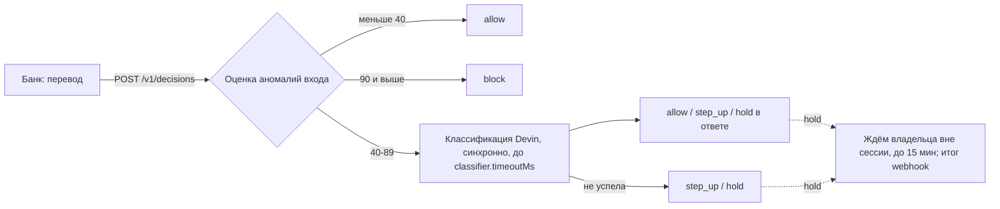

# Nightwatch

**Что.** SaaS перед бэк-офисом банка. Перед каждой исходящей операцией банк синхронно спрашивает
Nightwatch и получает `allow`, `step_up`, `hold` или `block`.

**Принцип.** Решаем по поведению и контексту. Пройденные биометрия, KYC и вход — не повод доверять:
их обманывают дипфейк и украденные данные.

**Трек:** синий — человек и транзакция. Задание: [hackathon-brief.md](hackathon-brief.md).

## Как принимается решение



## Фаза 1: аномалии входа

Сегодня распознаём только странный вход: кто и откуда вошёл в сессию, из которой идёт операция. Сумма,
получатель и частота операций — фаза 2. Все поля уже есть в
[схеме запроса](nightwatch-risk-request.schema.json).

| Сигнал, код причины | Условие | Поле запроса | Вес |
|---|---|---|---|
| Новое устройство `new_device` | впервые меньше 24 ч назад | `session.device_first_seen_at` | 30 |
| Анонимайзер `anonymizer_network` | VPN, Tor, прокси | `session.network.anonymizer` | 20 |
| Необычная страна `ip_country_unusual` | страна IP не встречалась в успешных входах клиента | `session.network.ip_country`, `history.recent_login_attempts` | 20 |
| Сброс доступа `recent_password_reset`, `recent_mfa_change` | пароль или MFA сменены меньше 24 ч назад | `session.last_password_reset_at`, `session.last_mfa_change_at` | 25 |
| Неудачные входы `failed_login_attempts` | 3+ неудачные попытки за 1 ч до входа | `history.recent_login_attempts` | 15 |
| Необычный час `off_hours` | вход вне обычных часов клиента | `session.authenticated_at`, `history.baseline.typical_active_local_hours` | 10 |
| Быстро к операции `login_to_transfer_fast` | от входа до операции меньше 60 с | `session.authenticated_at`, `transaction.requested_at` | 10 |

Пример: злоумышленник с нового устройства через VPN ночью сразу идёт к переводу → 30 + 20 + 10 + 10 =
70 → `hold`. Плюс чужая страна → 90 → `block`. Alice со своего телефона днём → 0 → `allow`.

## Оценка → решение

| Оценка | Решение | Кто решает |
|---|---|---|
| меньше 40 | `allow` | правила |
| 40–59 | `step_up` | LLM в границах правил |
| 60–89 | `hold` | LLM в границах правил (не ниже `step_up`) |
| 90 и выше | `block` | правила |

- **LLM не успела за `classifier.timeoutMs`** (по умолчанию 60 000 мс = 1 мин) → запасное правило из
  `classifier.fallback`: 40–59 → `step_up`, 60–89 → `hold`. Банк держит запрос до этого срока: его
  таймаут на вызов должен быть больше.
- **Ответ LLM проверяется:** значения только из списков, коды причин только из сигналов.
- **`step_up`** — ещё одно подтверждение в текущей сессии (экран с предупреждением, биометрия, PIN,
  код). Для среднего риска.
- **`hold`** — перевод остановлен, владельца спрашиваем вне сессии: звонок, пуш на старое
  устройство. Срок 15 мин, по таймауту `block`. Решение не окончательное (`final: false`), итог —
  webhook и `GET /v1/decisions/{id}`.

## Фаза 2 (после хакатона)

- **Бюджет без проверки:** окно 6 ч, до 5 операций и AED 2 000 (каждая до AED 1 000), в рискованном
  контексте ×0,1.
- **Сигналы операции:** сумма от 3× обычной, новый получатель за границей, всплеск, доля баланса,
  дробление, веер, дневной объём, мул.
- **Поиск схем по потоку** (Devin) с предложениями в конфигурацию.

## API

| Метод | Зачем |
|---|---|
| `POST /v1/decisions` | решение до исполнения: [запрос](nightwatch-risk-request.schema.json), [ответ](nightwatch-risk-response.schema.json) |
| `POST /v1/events` | входы, новые устройства, сбросы пароля |
| `GET /v1/decisions/{id}` | окончательное решение по `hold` |
| webhook → банк | решение изменилось, заведено дело |

У каждого банка свои ключ, конфигурация и данные. Работает у нас (SaaS) или контейнером в контуре банка.

## Анализ (Devin)

| Что | Когда | Результат |
|---|---|---|
| Классификация | синхронно, в серой зоне (40–89) | метка, уверенность, решение — в ответе банку |
| Разбор дела | в фоне, на ответ банку не влияет | вердикт и объяснение для аналитика и клиента |
| Поиск схем | раз в час и по кнопке | предложения в конфигурацию с цифрами: сколько поймали бы и сколько честных задели бы; для новой логики — PR с правилом и тестом |

Вызов Devin через CLI — около 6–8 с, в минуту по умолчанию укладывается. Обратный вызов банку нужен только для `hold`: итог там зависит от ответа владельца, а не от Devin.

## Конфигурация (на банк)

```yaml
loginSignals: { newDevice: 30, anonymizer: 20, unusualCountry: 20, accessReset: 25, failedLogins: 15, unusualHour: 10, fastToTransaction: 10 }
loginWindows: { newDeviceHours: 24, accessResetHours: 24, failedLoginsHour: 3, fastToTransactionSeconds: 60 }
decisions: { stepUp: 40, hold: 60, block: 90 }
classifier: { timeoutMs: 60000, fallback: { stepUp: step_up, hold: hold } }   # срок LLM, по умолчанию 1 мин
confirmation: { channel: push, timeoutMinutes: 15, onTimeout: block }
analyst: { provider: devin, apiKey: "apk_...", baseUrl: https://api.devin.ai, patternScan: hourly }
```

## Демо (5 мин)

1. Alice входит со своего телефона днём и платит → `allow`, мгновенно.
2. 02:00: злоумышленник прошёл FaceID и KYC от имени Alice — новое устройство, VPN, сразу к переводу.
3. Перевод AED 450 000 → аномалии входа, оценка 70 → Devin классифицирует «захват аккаунта» → `hold`.
4. «Телефон Alice»: «Это вы?» → «Нет» → `block`, сессия оборвана, деньги на месте.
5. Дело в консоли: сигналы входа и разбор Devin.

## Состав

- **API Nightwatch** (NestJS): решения, события, webhook, конфигурация, дела.
- **Демо-банк:** счета, переводы, вызывает `POST /v1/decisions`; сценарий атаки; экран «телефон Alice».
- **Консоль:** живые решения, дела, аналитика, конфигурация.
- **Postgres:** банки, конфигурации, решения, дела.

## Сроки

Заморозка кода 15:30 · сдача 16:00 (GitHub + видео в Cap) · демо 16:30.

## Открыто

- Название — Nightwatch?
- Предложения Devin в демо: правка конфигурации или PR?
- Схема `step_up`: каналы только в сессии (экран, биометрия, PIN, код); в запросе поле `step_up_result`.
  Согласовать с Андреем.
- Запрос требует `policy.fast_path_budget` и историю исходящих операций — в фазе 1 не нужны. Сделать
  необязательными? Согласовать с Андреем. В ответе `fast_path_budget` уже необязателен.
