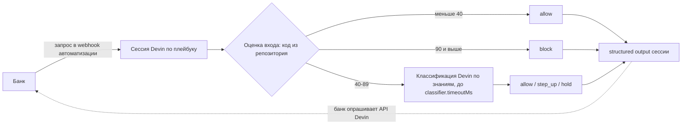

# Nightwatch

**Что.** Сервис на инфраструктуре Devin Cloud. Перед исходящей операцией банк присылает запрос и
получает `allow`, `step_up`, `hold` или `block`. Как банк отправляет запрос и забирает ответ (webhook,
опрос API Devin) — за рамками проекта.

**Принцип.** Решаем по поведению и контексту. Пройденные биометрия, KYC и вход — не повод доверять:
их обманывают дипфейк и украденные данные.

**Трек:** синий — человек и транзакция. Задание: [hackathon-brief.md](hackathon-brief.md).

## Как принимается решение



1. Автоматизация с webhook-триггером принимает запрос: тело уходит в промпт сессии (до 200 КБ).
   Одна автоматизация на банк, секрет триггера — ключ банка.
2. Сессия по плейбуку проверяет запрос по [схеме](nightwatch-risk-request.schema.json), запускает
   оценку (детерминированный код из репозитория) и сразу пишет решение правил в structured output.
3. Серая зона (40–89): классификация по знаниям, structured output переписывается
   (`decided_by: llm`). Не успела за `classifier.timeoutMs` (по умолчанию 60 000 мс) — остаётся
   запасное решение (`decided_by: fallback`).
4. `hold`: сессия ждёт ответа владельца сообщением в сессию до 15 мин, по таймауту `block`. Итог — тот
   же structured output с `final: true`.
5. Разбор дела для `hold` и `block` — та же сессия после решения, в `explanation.analyst`.

## Фаза 1: аномалии входа

Сегодня распознаём только странный вход: кто и откуда вошёл в сессию, из которой идёт операция. Сумма,
получатель и частота операций — фаза 2. Все поля уже есть в
[схеме запроса](nightwatch-risk-request.schema.json).

| Сигнал, код причины | Условие | Поле запроса | Вес |
|---|---|---|---|
| Новое устройство `new_device` | впервые меньше 24 ч назад | `session.device_first_seen_at` | 30 |
| Анонимайзер `anonymizer_network` | VPN, Tor, прокси | `session.network.anonymizer` | 20 |
| Необычная страна `ip_country_unusual` | страна IP не встречалась в успешных входах клиента | `session.network.ip_country`, `history.recent_login_attempts` | 20 |
| Сброс доступа `recent_password_reset`, `recent_mfa_change` | пароль или MFA сменены меньше 24 ч назад | `session.last_password_reset_at`, `session.last_mfa_change_at` | 25 |
| Неудачные входы `failed_login_attempts` | 3+ неудачные попытки за 1 ч до входа | `history.recent_login_attempts` | 15 |
| Необычный час `off_hours` | вход вне обычных часов клиента | `session.authenticated_at`, `history.baseline.typical_active_local_hours` | 10 |
| Быстро к операции `login_to_transfer_fast` | от входа до операции меньше 60 с | `session.authenticated_at`, `transaction.requested_at` | 10 |

Пример: злоумышленник с нового устройства через VPN ночью сразу идёт к переводу → 30 + 20 + 10 + 10 =
70 → `hold`. Плюс чужая страна → 90 → `block`. Alice со своего телефона днём → 0 → `allow`.

## Оценка → решение

| Оценка | Решение | Кто решает |
|---|---|---|
| меньше 40 | `allow` | правила |
| 40–59 | `step_up` | LLM в границах правил |
| 60–89 | `hold` | LLM в границах правил (не ниже `step_up`) |
| 90 и выше | `block` | правила |

- **Ответ LLM проверяется:** значения только из списков, коды причин только из сигналов.
- **`step_up`** — ещё одно подтверждение в текущей сессии банка (экран с предупреждением, биометрия,
  PIN, код). Для среднего риска.
- **`hold`** — перевод остановлен, владельца спрашиваем вне сессии банка: звонок, пуш на старое
  устройство. Срок 15 мин, по таймауту `block`. Пока ждём — `final: false`.

## Фаза 2 (после хакатона)

- **Бюджет без проверки:** окно 6 ч, до 5 операций и AED 2 000 (каждая до AED 1 000), в рискованном
  контексте ×0,1.
- **Сигналы операции:** сумма от 3× обычной, новый получатель за границей, всплеск, доля баланса,
  дробление, веер, дневной объём, мул.
- **Поиск схем по потоку** (Devin) с предложениями в конфигурацию.

## Что где в Devin Cloud

| Devin | У нас |
|---|---|
| Автоматизация с webhook-триггером | приём запроса; одна на банк |
| Плейбук | порядок решения: схема → оценка → классификация → structured output |
| Сессия и structured output (схема до 64 КБ, Draft 7) | одно решение; схема — [ответ](nightwatch-risk-response.schema.json) |
| Знания (knowledge) | сигналы, пороги, признаки захвата аккаунта |
| Репозиторий | код оценки (TypeScript), конфигурация банков `config/<bank>.yaml` |
| Секреты | ключ Devin API для поиска схем |
| Автоматизация по расписанию, раз в час | поиск схем по решениям за час → PR в конфигурацию с цифрами: сколько поймали бы, сколько честных задели бы |
| Devin App | консоль: решения и дела (приватная, вход через Devin) |

## Конфигурация (на банк, `config/<bank>.yaml`)

```yaml
loginSignals: { newDevice: 30, anonymizer: 20, unusualCountry: 20, accessReset: 25, failedLogins: 15, unusualHour: 10, fastToTransaction: 10 }
loginWindows: { newDeviceHours: 24, accessResetHours: 24, failedLoginsHour: 3, fastToTransactionSeconds: 60 }
decisions: { stepUp: 40, hold: 60, block: 90 }
classifier: { timeoutMs: 60000, fallback: { stepUp: step_up, hold: hold } }   # срок классификации, по умолчанию 1 мин
confirmation: { timeoutMinutes: 15, onTimeout: block }
devin: { automation: nightwatch-decide-<bank>, playbook: nightwatch-decision, patternScan: hourly }
```

Ключи — в секретах Devin, не в файле.

## Демо (5 мин)

1. Alice входит со своего телефона днём и платит → `allow` по правилам.
2. 02:00: злоумышленник прошёл FaceID и KYC от имени Alice — новое устройство, VPN, сразу к переводу.
3. Перевод AED 450 000 → сессия Devin: оценка 70 → классификация «захват аккаунта» → `hold`.
4. «Телефон Alice»: «Это вы?» → «Нет» → `block`, деньги на месте.
5. Консоль (Devin App): сигналы входа и разбор Devin.
6. Поиск схем раз в час: PR с правкой порогов и цифрами.

## Состав

- **Репозиторий:** оценка входа (TypeScript, запуск из сессии), схемы, `config/`, плейбук и знания в
  `devin/`, скрипт, который создаёт автоматизации, плейбук и знания через API v3.
- **Демо-банк:** скрипт или страница — шлёт запрос в webhook и опрашивает сессию. Только для показа.
- **Консоль:** Devin App.

## Ограничения Devin Cloud

- **Тариф.** Бесплатный облачные сессии не запускает: проверено, `out_of_quota`. Облако — с Pro
  ($20/мес); есть ли на Pro API и автоматизации — не видно на странице цен.
- **Каждое решение — сессия Devin.** Время старта и цена сессии не измерены — первое, что меряем.
- **Автоматизации:** 50 запусков в час на старте, очередь настраивается.
- **Devin App** засыпает через 5 мин без запросов, только для вошедших в Devin.

## Сроки

Заморозка кода 15:30 · сдача 16:00 (GitHub + видео в Cap) · демо 16:30.

## Открыто

- Доступ к облаку: Pro за $20 или кредиты у Cognition на площадке.
- Схема ответа сейчас Draft 2020-12, для structured output нужна Draft 7.
- Название — Nightwatch?
- Схема `step_up`: каналы только в сессии банка (экран, биометрия, PIN, код); в запросе поле
  `step_up_result`. Согласовать с Андреем.
- Запрос требует `policy.fast_path_budget` и историю исходящих операций — в фазе 1 не нужны. Сделать
  необязательными? Согласовать с Андреем. В ответе `fast_path_budget` уже необязателен.
